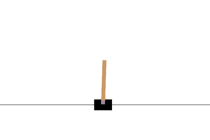
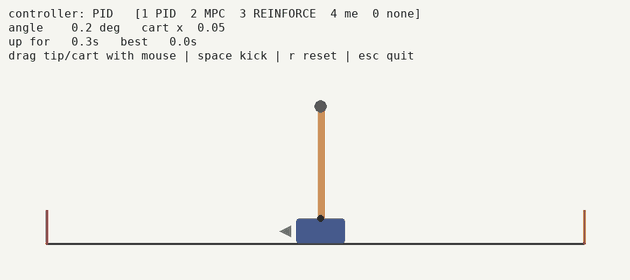
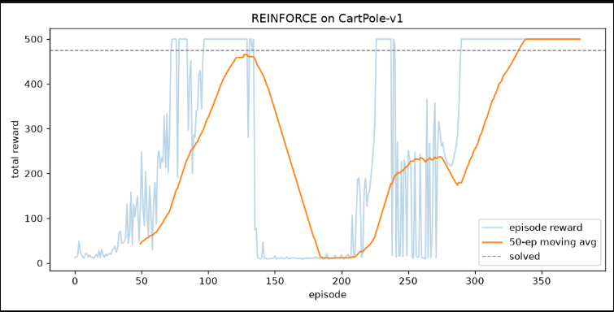
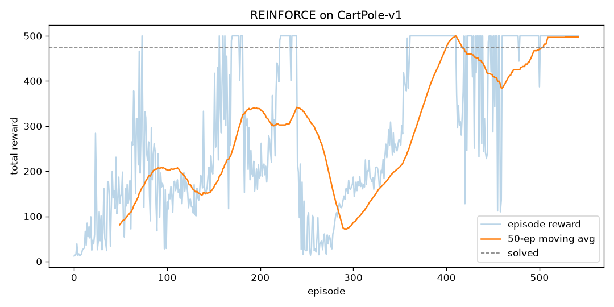
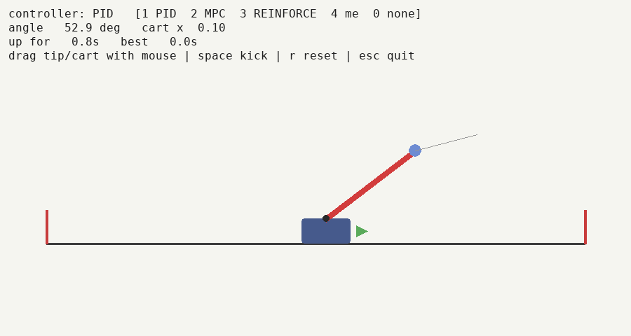

<h1 align="center">CartPole: RL vs classic control</h1>

<p align="center">
  
  
  
  
  
</p>

<p align="center">
  
  &nbsp;
  
</p>
<p align="center"><sub>left: my REINFORCE agent after ~540 episodes of training &nbsp;|&nbsp; right: shoving the pole with the mouse while PID recovers</sub></p>

---

I'm playing around with reinforcement learning, on a laptop with no GPU. CartPole-v1 is the classic first problem, so I'm solving it a few different ways and comparing them: hand-tuned control (PID, MPC) next to RL agents that only ever see the reward.

There's also an interactive mode where you can grab the pole or the cart with the mouse and see which controller survives what.

## Results

Each method is evaluated on the same 100 seeded episodes. Max score is 500.

| method | learns? | needs | mean score | how far the cart wanders (avg max \|x\|) |
|---|---|---|---|---|
| random | no | nothing | 25.0 | – |
| PID | no | 5 hand-tuned gains | **500** | **0.12** |
| MPC | no | the exact physics equations | **500** | 0.69 |
| REINFORCE | yes | just the reward, ~540 episodes / under a minute of CPU | **500** | 0.42 |

The cart dies at \|x\| = 2.4.

All three solve it. The interesting part is what each one needed. PID needs someone who understands the system, MPC needs the exact model, and REINFORCE figured it out from +1 per timestep without ever seeing the physics.

## REINFORCE

Vanilla policy gradient: a small network (4 → 128 → 2, 898 params) outputs action probabilities. After each episode it pushes up the log-prob of actions that were followed by above-average return and pushes down the rest.

<p align="center">
  
  
</p>

The big crashes are real. In the lr = 1e-2 run it hits 500 around episode 100, then falls apart to ~10 per episode by episode 140. I logged the policy during that run and it was getting worse *while still scoring 500*. Two things cause it:

- **truncation.** At 500 steps the episode is cut off, not failed, but plain Monte Carlo returns can't tell the difference. The last third of every perfect episode gets a below-average return just because the clock was running out, so good actions get pushed down.
- **noisy single-episode updates.** Each update is based on one episode, and a big enough step can push the policy past a tipping point.

Lowering the lr helps on average but doesn't fix it. Over 6 seeds each:

| lr | median episodes to solve | worst seed | runs that crashed at least once |
|---|---|---|---|
| 1e-2 | ~615 | 1260 | 4 / 6 |
| 5e-3 | ~415 | 681 | 4 / 6 |

The seed matters about as much as the lr, so one run doesn't tell you much.

## Interactive mode

<p align="center"></p>

```bash
python -m interactive.app                   # starts with PID
python -m interactive.app --start reinforce
```

- **mouse:** grab the pole tip and drag to shove it, or grab the cart and drag to pull it
- **keys:** `1` PID, `2` MPC, `3` REINFORCE, `4` drive it yourself with the arrow keys, `0` nothing, `space` random kick, `r` reset

Unlike real CartPole, the episode doesn't end at 12°. The pole just turns red, and the episode only ends if it actually falls or the cart hits a wall.

Things I noticed:
- **PID handles the biggest shoves.** Its rule (push towards the lean) works at any angle.
- **MPC keeps the pole perfectly vertical and then drives into the wall.** It only looks 0.2s ahead and barely cares about cart position. Raising the position cost made it *worse*, because to move the cart left you first have to push right so the pole tips left, and a 0.2s horizon can't see that.
- **REINFORCE falls apart after a medium shove.** It never saw angles past 12° in training (the episode ended there), so a 30° pole is completely out of distribution for it.

## Project structure

```
├── baselines/
│   ├── random_agent.py    # random actions, the floor to beat
│   ├── pid.py             # PID on the angle + PD on cart position
│   └── mpc.py             # brute-force MPC over all 2^10 action sequences
├── agents/
│   ├── reinforce.py       # REINFORCE training
│   └── play.py            # watch a trained agent
├── interactive/
│   └── app.py             # mess with the pole while a controller balances it
├── models/                # trained weights
├── results/               # training plots
└── assets/                # gifs/images for this readme
```

## Setup

```bash
git clone <this repo>
cd Cartpole
python -m venv .venv
source .venv/bin/activate
pip install torch --index-url https://download.pytorch.org/whl/cpu   # CPU-only torch
pip install -r requirements.txt
```

Everything runs from the repo root with `python -m`:

```bash
python -m baselines.random_agent
python -m baselines.pid --render -n 3
python -m baselines.mpc --render -n 3
python -m agents.reinforce          # train (under a minute), saves to models/ and results/
python -m agents.play -n 5          # watch the trained agent
```

## Next

- [ ] DQN (value-based, and it handles truncation properly by bootstrapping)
- [ ] actor-critic / PPO, aimed at the crashes above
- [ ] train with random shoves so the RL agent survives the interactive mode
